<div align="center">


<a href="https://ericx00.itch.io"></a>
<a href="https://www.youtube.com/@Chesstropolis"></a>
<a href="https://x.com/ErickMuteti254"></a>
<a href="https://whop.com/erick-muteti/"></a>


</div>

<br/>

<div align="center">

</div>

```diff
+ [SAVE FILE LOADED] ericx00.sav
+ status ............ GRADUATED · BSc Mathematics & Computer Science, Maseno University 🎓
+ open to ........... software, security & game-dev roles · collabs · freelance
! warning ........... may challenge you to a blitz game mid-standup
```

---

## 🕹️ PLAYER 1

<div align="center">

</div>

I'm a maths + CS grad from Kenya who likes building things end to end: web apps, automation scripts, security tooling and **pixel-art game assets**. I hunt bugs with Burp Suite (top-10 Kenyan hunters on HackerOne at one point), forge retro asset packs for indie devs, and stream chess on **Chesstropolis**.

---

## 🎮 NOW PLAYING · my games

<table>
<tr>
<td align="center" width="50%">
<a href="https://ericx00.itch.io/emberdeep"></a>
<br/><b>🔥 EMBERDEEP</b><br/>
<sub>A deckbuilder with no energy. Every card heats the forge.</sub><br/>
<a href="https://ericx00.itch.io/emberdeep"></a>
</td>
<td align="center" width="50%">
<a href="https://ericx00.itch.io/eight-lands"></a>
<br/><b>⚔️ EIGHT LANDS</b><br/>
<sub>Free pixel platformer: run, jump and fight through eight lands as a knight, mage or ranger.</sub><br/>
<a href="https://ericx00.itch.io/eight-lands"></a>
</td>
</tr>
</table>

## 🛒 ITEM SHOP · AssetForge on itch.io

> Pixel sprites, UI kits, fonts, VFX and retro SFX for indie devs. Grab the free starters and level up from there.

<table>
<tr>
<td align="center"><a href="https://ericx00.itch.io/assetforge-starter"></a><br/><sub><b>AssetForge Starter</b><br/>🆓 FREE</sub></td>
<td align="center"><a href="https://ericx00.itch.io/heroes-and-monsters"></a><br/><sub><b>Heroes &amp; Monsters</b><br/>27 animated characters</sub></td>
<td align="center"><a href="https://ericx00.itch.io/pixel-ui-kit"></a><br/><sub><b>Pixel UI Kit</b><br/>325 sprites · 5 themes</sub></td>
<td align="center"><a href="https://ericx00.itch.io/retro-sfx-pack"></a><br/><sub><b>Retro SFX Pack</b><br/>155 sounds</sub></td>
</tr>
<tr>
<td align="center"><a href="https://ericx00.itch.io/cozy-farm-lite"></a><br/><sub><b>Cozy Farm LITE</b><br/>🆓 FREE</sub></td>
<td align="center"><a href="https://ericx00.itch.io/cozy-farm-ui"></a><br/><sub><b>Cozy Farm UI Kit</b><br/>4 seasons · 82 icons</sub></td>
<td align="center"><a href="https://ericx00.itch.io/forge-deckbuilder-kit"></a><br/><sub><b>Forge Deckbuilder Kit</b><br/>cards · UI · SFX</sub></td>
<td align="center"><a href="https://ericx00.itch.io/forge-parallax-backgrounds"></a><br/><sub><b>Parallax Backgrounds</b><br/>32 layered scenes</sub></td>
</tr>
<tr>
<td align="center"><a href="https://ericx00.itch.io/forge-pixel-space-starter"></a><br/><sub><b>Pixel Space Starter</b><br/>🆓 FREE</sub></td>
<td align="center"><a href="https://ericx00.itch.io/forge-pixel-vfx-starter"></a><br/><sub><b>Pixel VFX Starter</b><br/>🆓 FREE</sub></td>
<td align="center"><a href="https://ericx00.itch.io/forge-parallax-sampler"></a><br/><sub><b>Parallax Sampler</b><br/>🆓 FREE</sub></td>
<td align="center"><a href="https://ericx00.itch.io/assetforge-complete"></a><br/><sub><b>AssetForge Complete</b><br/>⭐ best value bundle</sub></td>
</tr>
</table>

<div align="center">
<a href="https://ericx00.itch.io"></a>
<a href="https://itch.io/c/8504354/forge-assets"></a>
</div>

---

## 🎒 INVENTORY · tech stack

<div align="center">

**⚔️ Weapons (languages)**<br/>


**🛡️ Armor (frameworks & tools)**<br/>


**🔮 Spells (security, ops & game dev)**<br/>


</div>

---

## 📜 QUEST LOG

| | Quest | Status |
|:-:|---|---|
| 🎓 | **Graduate: BSc Mathematics & Computer Science, Maseno University** | ✅ COMPLETE |
| ⚒️ | Ship 20 game asset packs + games on itch.io | ✅ COMPLETE |
| ♟️ | Push [Chesstropolis](https://www.youtube.com/@Chesstropolis) to 10k subscribers | 🟧 IN PROGRESS |
| 🐞 | Hunt bugs, write reports, climb the HackerOne boards | 🟧 IN PROGRESS |
| ⚖️ | `lawAi`: an AI study buddy for Kenyan law students prepping for the bar | 🟧 IN PROGRESS |
| 🏦 | [`chama`](https://github.com/ericx00/chama) & [`rentsync`](https://github.com/ericx00/rentsync): software for real Kenyan problems | 🟩 SHIPPED |
| 💼 | Land the next role: software / security / game dev | 🔓 OPEN TO OFFERS |

<details>
<summary><b>🗺️ Pinned dungeons (public repos worth a look)</b></summary>
<br/>

| Repo | What it is |
|---|---|
| [chama](https://github.com/ericx00/chama) | Laravel record-keeping system for community savings groups |
| [rentsync](https://github.com/ericx00/rentsync) | Rent management system |
| [carbonlock](https://github.com/ericx00/carbonlock) | Carbon-credit project |
| [OFF-Guard](https://github.com/ericx00/OFF-Guard) | Off Guard web project |
| [youtube_-video_uploader](https://github.com/ericx00/youtube_-video_uploader) | Python automation for creator uploads |
| [simple_shell](https://github.com/ericx00/simple_shell) | My own UNIX shell in C (ALX) |
| [HTTP_SERVER](https://github.com/ericx00/HTTP_SERVER) | A tiny HTTP server in Rust |
| [Tic-tac-toe](https://github.com/ericx00/Tic-tac-toe) | Terminal tic-tac-toe in C++ |

</details>

---

## ♟️ BONUS STAGE · solve my puzzle

<table>
<tr>
<td width="50%" align="center"></td>
<td width="50%">

**White to move. Mate in 1.**

Black just played a "natural developing move"… and blundered. Can you find the finisher?

<details>
<summary>🔓 <b>Reveal the answer</b></summary>
<br/>

### `Qxf7#` 👑

The queen takes on f7, protected by the bishop on c4. The king can't take back and has nowhere to run. That's the **Scholar's Mate**.

Want more? I post chess Shorts and streams on
[**Chesstropolis**](https://www.youtube.com/@Chesstropolis) ♞

</details>

</td>
</tr>
</table>

---

## 🐍 BOSS FIGHT · my contribution graph

<div align="center">
<picture>
  <source media="(prefers-color-scheme: dark)" srcset="https://raw.githubusercontent.com/ericx00/ericx00/output/snake-dark.svg" />
  <source media="(prefers-color-scheme: light)" srcset="https://raw.githubusercontent.com/ericx00/ericx00/output/snake-light.svg" />
  
</picture>
</div>

---

<div align="center">

```
 ██████╗  █████╗ ███╗   ███╗███████╗     ██████╗ ███╗   ██╗
██╔════╝ ██╔══██╗████╗ ████║██╔════╝    ██╔═══██╗████╗  ██║
██║  ███╗███████║██╔████╔██║█████╗      ██║   ██║██╔██╗ ██║
██║   ██║██╔══██║██║╚██╔╝██║██╔══╝      ██║   ██║██║╚██╗██║
╚██████╔╝██║  ██║██║ ╚═╝ ██║███████╗    ╚██████╔╝██║ ╚████║
 ╚═════╝ ╚═╝  ╚═╝╚═╝     ╚═╝╚══════╝     ╚═════╝ ╚═╝  ╚═══╝
```

<sub>INSERT COIN TO CONTINUE · built with pixels, Python and too much chess</sub>

</div>
