<div align="center">



<sub>☀️🌙 The sky above follows real Nairobi time and weather. It's redrawn every hour by a GitHub Action.</sub>

<br/><br/>


<a href="https://x.com/ErickMuteti254"></a>


<br/><br/>



</div>

```diff
+ [SAVE LOADED] ericx00.sav
+ status: GRADUATED 🎓
+ BSc Maths & Computer Science
+ Maseno University
! open to software & security roles
```

## 🕹️ PLAYER 1

<div align="center">

</div>

I'm a **Maths + Computer Science graduate** from Kenya who builds things end to end: web apps, automation scripts and security tooling. I hunt bugs with Burp Suite (at one point a top-10 Kenyan hunter on HackerOne), trained in low-level C and systems at **ALX**, and like solving real local problems with software.

## 🎒 INVENTORY

<div align="center">

**⚔️ Languages**<br/>


**🛡️ Frameworks & data**<br/>


**🔮 Security & ops**<br/>


</div>

## 📜 QUEST LOG

- ✅ **Graduate:** BSc Mathematics & Computer Science, Maseno University
- ✅ **ALX Software Engineering:** C, shell, Python, DevOps
- ✅ **Ship** [`chama`](https://github.com/ericx00/chama): finance records for community savings groups
- 🟧 **Building** `lawAi`: an AI study buddy for Kenyan law students prepping for the bar
- 🟧 **Hunting** bugs and writing reports on HackerOne
- 🔓 **Next quest:** a software / security role. Let's talk!

## 🗺️ DUNGEONS · featured repos

| Repo | Loot |
|---|---|
| [chama](https://github.com/ericx00/chama) | Laravel record-keeping for community savings groups |
| [rentsync](https://github.com/ericx00/rentsync) | Rent management system (JS) |
| [carbonlock](https://github.com/ericx00/carbonlock) | Carbon-credit project |
| [Landvaluation](https://github.com/ericx00/Landvaluation) | Land valuation in Python |
| [youtube_-video_uploader](https://github.com/ericx00/youtube_-video_uploader) | Python upload automation |
| [simple_shell](https://github.com/ericx00/simple_shell) | My own UNIX shell in C |
| [HTTP_SERVER](https://github.com/ericx00/HTTP_SERVER) | Tiny HTTP server in Rust |
| [Desktop_Organizer](https://github.com/ericx00/Desktop_Organizer) | Python script that tidies your desktop |
| [Tic-tac-toe](https://github.com/ericx00/Tic-tac-toe) | Terminal tic-tac-toe in C++ |

## 🐍 BOSS FIGHT · contribution graph

<div align="center">
<picture>
  <source media="(prefers-color-scheme: dark)" srcset="https://raw.githubusercontent.com/ericx00/ericx00/output/snake-dark.svg" />
  <source media="(prefers-color-scheme: light)" srcset="https://raw.githubusercontent.com/ericx00/ericx00/output/snake-light.svg" />
  
</picture>
</div>

## ♟️ BONUS STAGE

<div align="center">

</div>

**White to move, mate in 1.** Black just played a "natural" developing move… and blundered.

<details>
<summary>🔓 <b>Reveal the answer</b></summary>
<br/>

**`Qxf7#`** 👑 The queen takes on f7, defended by the bishop on c4, and the king has nowhere to go. That's the Scholar's Mate.

</details>

<details>
<summary>🛠️ <b>How this profile works</b></summary>
<br/>

- All the pixel art is hand-written SVG + CSS animation, made by [`tools/gen.py`](tools/gen.py). No images or JavaScript.
- [`sky.yml`](.github/workflows/sky.yml) runs every hour. It reads Nairobi time and the live weather ([Open-Meteo](https://open-meteo.com)) and works out the real moon phase, then redraws the header: day, dawn, dusk or night, with sun, moon, clouds, rain, storms, birds and fireflies.
- [`snake.yml`](.github/workflows/snake.yml) turns my contribution graph into a snake game twice a day.

</details>

<div align="center">
<br/>

</div>
