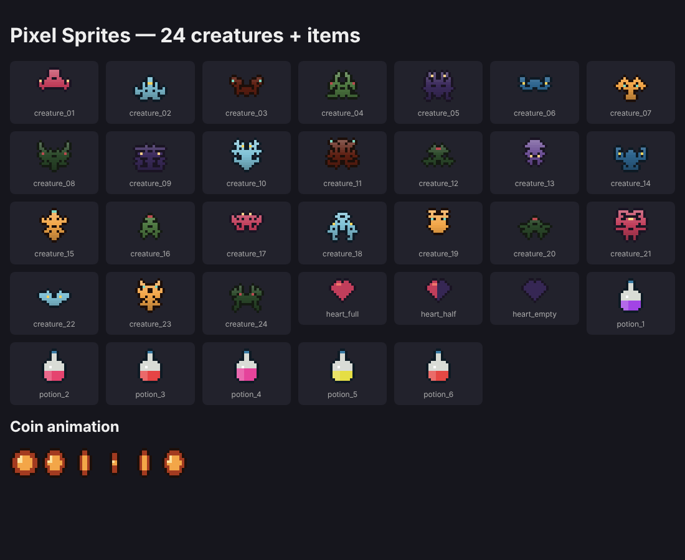
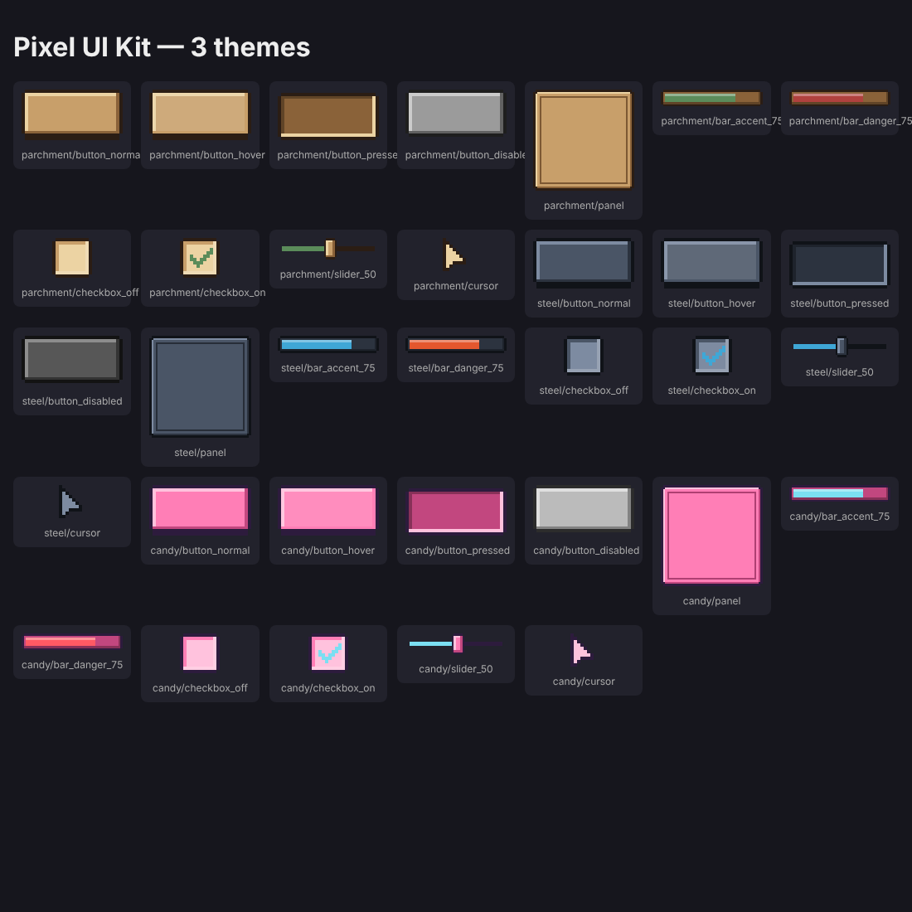

# AssetForge — procedural game asset packs (B2B, no ToS risk)

Generates **original** assets for indie developers, in pure Python with no dependencies:

| Pack | Contents |
|---|---|
| **Retro SFX** | 13 recipes × N variants (coin, jump, laser, explosion, hit, power-up, pickup, footstep, UI click/hover, confirm, cancel, error). 16-bit WAV, peak-normalised, click-free edges |
| **Pixel Sprites** | Mirrored procedural creatures (no floating pixels), spinning-coin animation, hearts (full/half/empty), potions, sprite sheets, `metadata.json` with animation frame data |
| **Pixel UI Kit** | 3 themes × buttons (normal/hover/pressed/disabled), panels, bars, checkboxes, slider, cursor. 9-slice ready with documented margins for Unity, Godot and CSS |

Everything comes at 1× and 4× (nearest-neighbour), with a `preview.html` for store screenshots, a license file, and a zip per pack.
Output is seeded, so every build is reproducible and every seed is a new variant.




```bash
python3 -m unittest discover -s tests -t .          # 10 tests
python3 -m assetforge build --out dist              # all packs + zips (< 1 s)
python3 -m assetforge build --sfx-variants 8 --creatures 64
python3 -m assetforge sfx laser 42 laser.wav        # one-off
python3 -m assetforge creature 7 ember monster.png  # one-off (8x)
```

## Quality bar before you sell

The generator is the engine. The product is a **curated** pack:
1. Generate many seeds, keep the best ~30–50%. Buyers pay for taste.
2. **Listen to every sound** on headphones and on laptop speakers. The tests check levels, clicks and determinism, but they can't judge whether a sound is good.
3. Add a few hand-touched hero pieces (e.g. a logo-quality title panel) and use them as listing thumbnails.
4. Ship a small **free sample pack** on itch.io. It drives most of the paid sales and reviews.

## Selling it

- **itch.io:** the main marketplace for indie asset packs. Pixel UI kits and SFX packs both sell there. Comparable packs list at roughly $5–$30, with bundles discounted heavily during sales. Check the current top sellers in your category before pricing.
- **Unity Asset Store / Godot Asset Library / GameDev Market:** each has submission requirements and revenue share. Read their current terms.
- **Marketing:** r/gamedev and r/PixelArt (follow self-promo rules), itch.io devlogs, short GIFs of the UI kit in a mock game screen, and game jams (a free pack that's "jam-legal" gets used and credited).

## Extend

- New SFX: add a function to `assetforge/sfx.py` and register it in `RECIPES`
- New palettes/themes: `sprites.PALETTES`, `ui.THEMES`
- Next packs: tilesets (autotile 47-blob), particle sprite sheets, ambient loops
