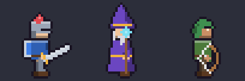
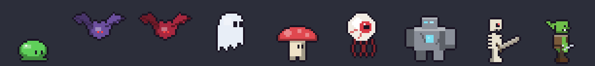
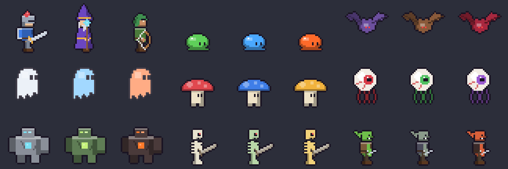
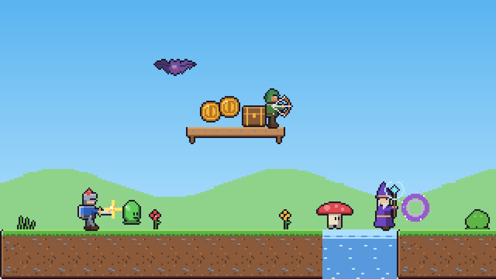
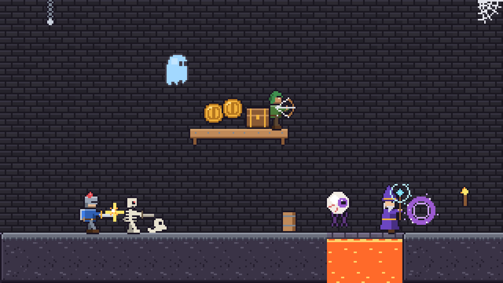
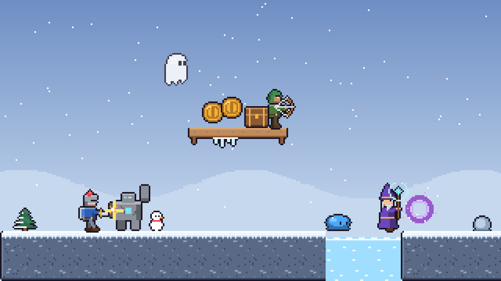
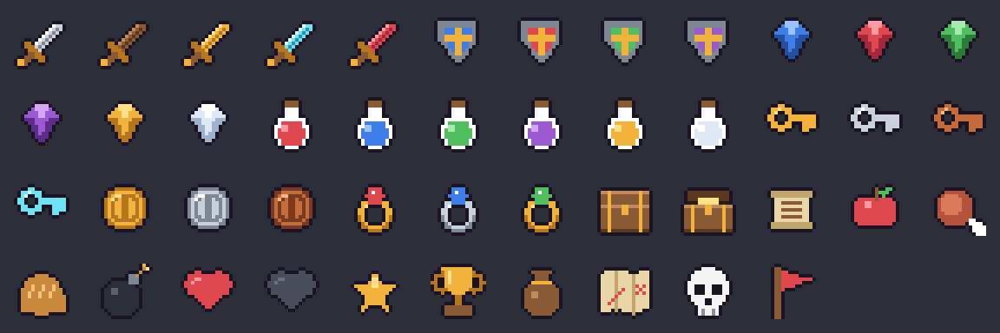
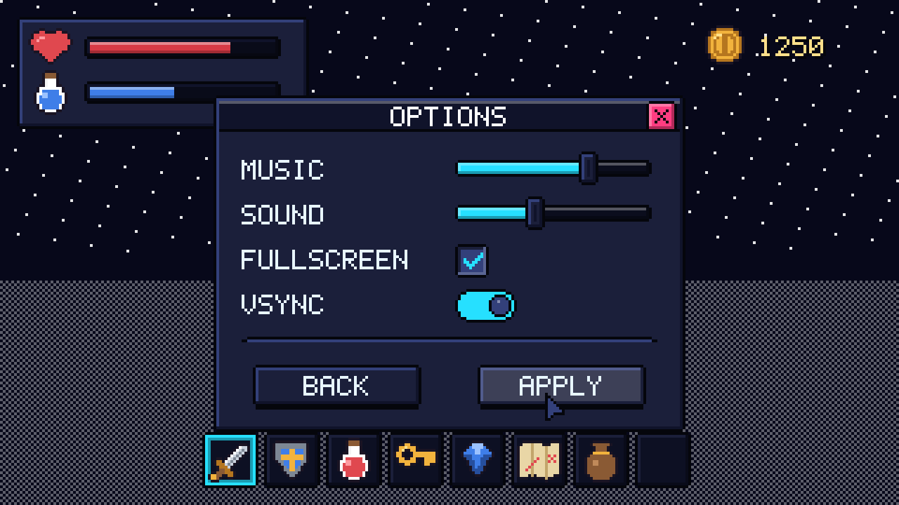
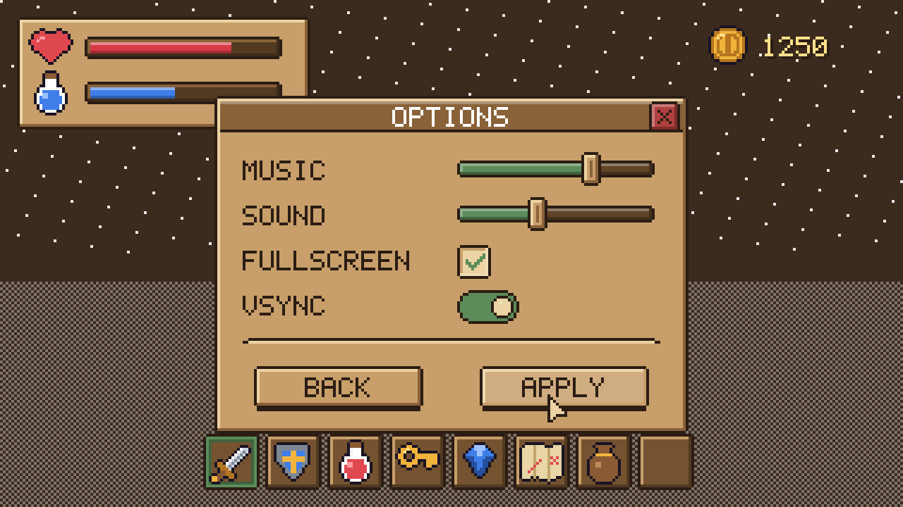
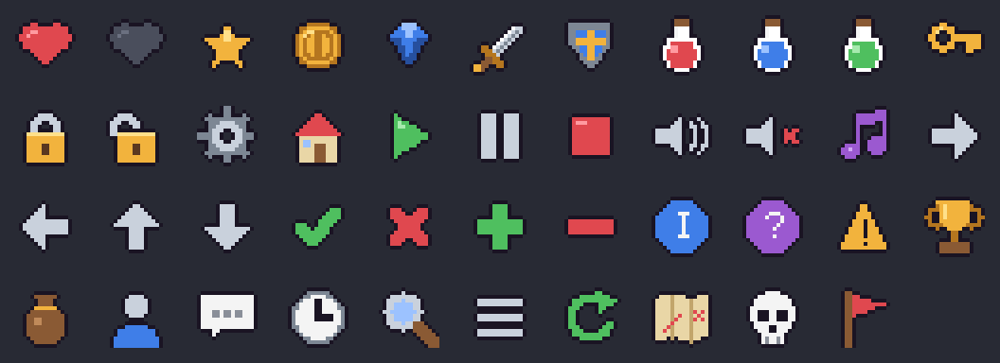

# AssetForge — procedural game asset packs (B2B, no ToS risk)

Generates **original** assets for indie developers, in pure Python with no dependencies:

| Pack | Contents |
|---|---|
| **Retro SFX** | **155 sounds**: 31 types × 5 variants in 6 categories (UI, pickups, movement, combat, magic, jingles). WAV **and** OGG, anti-aliased oscillators, loudness-matched per category (peaks ≤ −1 dBFS), click-free edges, a preview reel and `sounds.csv` |
| **Pixel Sprites** | **3 heroes** (knight, mage, ranger) and **24 monsters** (8 designed types × 3 colour variants: slime, bat, ghost, mushroom, floating eye, golem, skeleton, goblin), every one with **idle, move, attack, hurt and death** animations (32×32). Plus 46 items in material tiers, 7 animated effects, and a tileset in **3 themes** (grassland, dungeon, snow) with Tiled `.tsx` files. Animated GIF previews and a level mock-up per theme, built only from the pack |
| **Pixel UI Kit** | 5 themes × 65 elements (325 sprites): buttons in 3 sizes × 4 states, icon buttons, panels, dialog, tooltip, ribbon banner, tabs, inventory slots, bars (frame + 4 fills), sliders, checkboxes, radios, toggles, scrollbars, input, dropdown, close buttons, 3 cursors. Plus **43 icons**, the **Forge 5x7 bitmap font** (BMFont `.fnt`), a sprite atlas + JSON per theme with 9-slice borders, a mock-up game screen per theme, and a CSS 9-slice demo |

Everything comes at 1× and 4× (nearest-neighbour), with a `preview.html` for store screenshots, a license file, and a zip per pack.
Output is seeded, so every build is reproducible and every seed is a new variant.












Every pixel of the mock-up screens comes from the kit itself: panels, dialog, bars, slider, toggle, slots, icons and font.

```bash
python3 -m unittest discover -s tests -t .          # 23 tests
python3 -m assetforge build --out dist              # all packs + zips (~20 s; OGG/MP3 need ffmpeg, WAV always works)
python3 -m assetforge build --sfx-variants 8 --creatures 64
python3 -m unittest discover -s tests -t .          # quality gates: loudness, aliasing, duplicates, atlas overlap
python3 -m assetforge sfx laser 42 laser.wav        # one-off
python3 -m assetforge creature 7 ember monster.png  # one-off (8x)
python3 -m assetforge starter --out dist             # free sample pack for itch.io (lead magnet)
```

## Quality bar before you sell

The generator is the engine. The product is a **curated** pack:
1. Generate many seeds, keep the best ~30–50%. Buyers pay for taste.
2. **Listen to every sound** on headphones and on laptop speakers. The tests check loudness, peaks, clicks, aliasing and near-duplicate variants, but they can't judge whether a sound is good.
3. Add a few hand-touched hero pieces (e.g. a logo-quality title panel) and use them as listing thumbnails.
4. Ship a small **free sample pack** on itch.io. It drives most of the paid sales and reviews.

## Selling it

- **itch.io:** the main marketplace for indie asset packs. Pixel UI kits and SFX packs both sell there. Comparable packs list at roughly $5–$30, with bundles discounted heavily during sales. Check the current top sellers in your category before pricing.
- **Unity Asset Store / Godot Asset Library / GameDev Market:** each has submission requirements and revenue share. Read their current terms.
- **Marketing:** r/gamedev and r/PixelArt (follow self-promo rules), itch.io devlogs, short GIFs of the UI kit in a mock game screen, and game jams (a free pack that's "jam-legal" gets used and credited).

## Extend

- New SFX: add a function to `assetforge/sfx.py` and register it in `RECIPES`
- New palettes/themes: `sprites.PALETTES`, `ui.THEMES` (a theme is 8 colours; every element and mock-up follows)
- Next packs: tilesets (autotile 47-blob), particle sprite sheets, ambient loops

## Deckbuilder Kit (new)

`python3 -m assetforge deck --out dist` builds two more packs:

- **Forge Deckbuilder Kit**: 40 card frames (5 types x 4 rarities, with and without labels), 6 card backs, 69 card-game icons,
  50 battle UI parts, 4 pixel fonts (TTF + BMFont), 268 sound effects (67 sounds x 4 variations) and 5 seamless music loops.
- **Forge Deckbuilder Starter (free)**: 5 frames, 24 icons, 22 UI parts, 2 fonts, 32 sounds and 1 music loop.

The exact counts are written by the build into each pack's `metadata.json` and `README.md`.
TTF export needs `pip install fonttools` at build time (the packs themselves have no dependencies); everything else is stdlib.
Modules: `deck.py` (frames, backs, UI), `deckicons.py`, `pixfonts.py`, `cardsfx.py`, `music.py`, `deckpack.py`.
