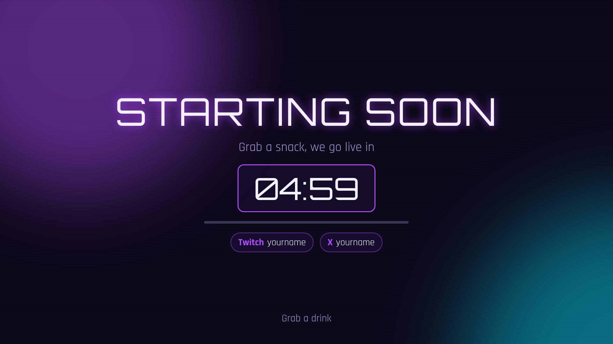
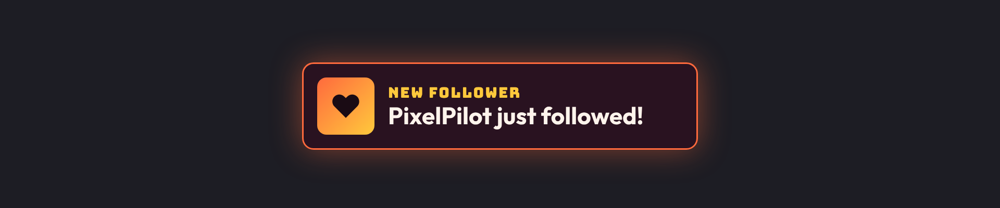

# OverlayKit — themeable stream overlay packs

A code-first overlay pack generator. One codebase → multiple themed packs you can sell
separately or as a bundle. Every pack has:

- **OBS browser-source scenes:** Starting Soon (live countdown + progress bar), BRB, Ending, Lower third (rotating messages), Webcam frame (any size, name tag)
- **Live alerts:** a StreamElements custom widget (follows, subs, gifted subs, tips, cheers, raids), queued so alerts never overlap, with min-bits/min-tip filters and custom sound. Viewer names are HTML-escaped, so nobody can inject markup into your overlay.
- **Twitch panels:** About, Schedule, Rules, Discord, Donate, Setup, Socials, Merch (SVG + 320×100 PNG)
- **Store previews:** PNG screenshots of every scene, rendered in headless Chromium, plus `gallery.html`
- `OBS-SETUP.txt` and a license file for buyers




Everything is customisable with URL parameters (`?theme=neon&title=…&socials=twitch:me,x:me&minutes=10&accent=ff00aa`)
so one purchase covers many looks. Animations only use `transform`/`opacity`, which keeps OBS CPU use low.

## Build

```bash
npm test                    # 9 tests (params, themes, countdown, alert text/escaping, queue, widget end-to-end)
npm run build               # dist/overlaykit-<theme>/ + .zip for each theme, previews via Playwright if installed
node scripts/build.js --no-png
```

Add a theme: add an entry to `themes.json` (6 colours + 2 Google Fonts) and rebuild. That's a new product in five minutes.

Preview any scene in a browser: `overlays/starting-soon.html?theme=sunset&minutes=1`, or
`overlays/alerts.html?theme=neon&demo=1` for an alert loop (record this for promo clips).

## Selling it

| Channel | Notes |
|---|---|
| Own store (Gumroad / Lemon Squeezy / Payhip) | Highest margin. Single theme ~$9–15, all-themes bundle ~$29. Check what comparable packs charge before you set prices. |
| Etsy | Surprisingly big for "Twitch overlay" searches. Use the PNG previews as listing images. |
| Marketplaces (e.g. Own3d, Nerd or Die, StreamElements' theme gallery) | Each has its own submission and revenue-share terms, so read them first. |

**Marketing:** 15-second TikTok/Shorts "before → after" of a plain stream vs. themed
(the `demo=1` alert loop + Starting Soon countdown records well). Offer one theme free as a
lead magnet and collect emails for the next themes. Target small streamers "leveling up" in
r/Twitch and streamer Discord servers (follow each community's self-promo rules).

## Layout

```
themes.json                 colour/font tokens per theme
overlays/                   scenes + lib.js (shared runtime) + themes.js (generated)
widgets/alerts/             StreamElements widget source (lib.js gets inlined at build)
scripts/build.js            packs, PNG rendering, zips, gallery
scripts/panels.js           panel SVG generator
scripts/streamelements.js   widget bundler + fields.json per theme
```

## Next

- Streamlabs and Streamer.bot alert variants
- Animated (WebM) alert stingers rendered from the HTML
- Chat box overlay, goal bars (follower/sub goals)
- Animated panel variants and emote-style badge packs
