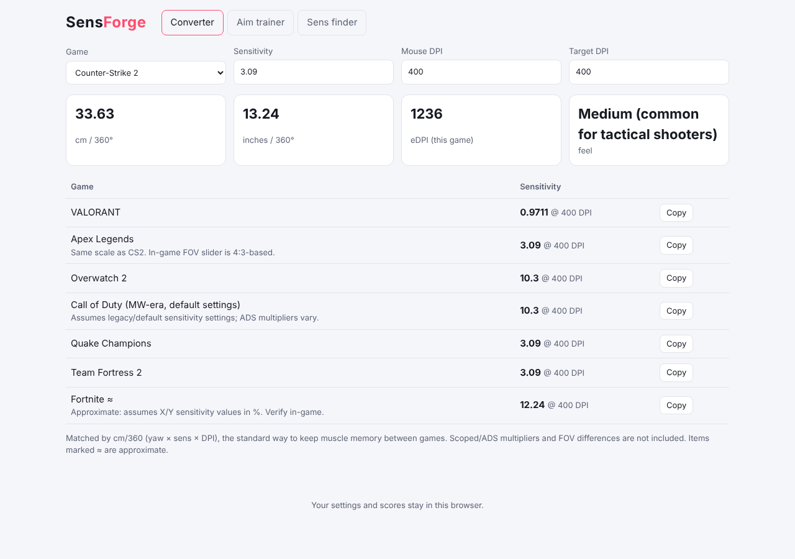

# SensForge — sensitivity converter, sens finder & aim trainer

A zero-dependency web app for FPS players:

1. **Converter:** match cm/360 across CS2, VALORANT, Apex, Overwatch 2, CoD, Quake, TF2 and Fortnite (marked ≈), with DPI changes, cm/in per 360, eDPI and a feel rating. Shareable links (`?game=cs2&sens=3.09&dpi=400`).
2. **Aim trainer:** a real 3D camera driven by **your in-game sensitivity**: mouse counts × yaw × sens = degrees, with the game's FOV, so a 40° flick here takes the same hand movement as in-game. Uses raw input (`unadjustedMovement` pointer lock) where the browser supports it. Modes: Gridshot, Micro-flick, Wide flick, Tracking. Best scores per sensitivity are kept in the browser.
3. **Sens finder (PSA):** A/B wide-flick rounds that halve the range each time, so seven rounds land within a few percent of your preferred sens. Then one click converts the result to every game.



```bash
npm test          # math, PSA, projection, sessions
npm run serve     # http://localhost:5173  (ES modules need http, not file://)
```

Deploy: it's static, so push to GitHub Pages / Cloudflare Pages / Netlify as is.

## Accuracy notes

Yaw values: CS2/Apex/Quake/TF2 0.022, VALORANT 0.07, OW2 0.0066, CoD (default settings) 0.0066, Fortnite 0.005555 (approximate, depends on how sensitivity is set). Tests pin the published reference
conversions (VALORANT→CS2 ×3.18, CS2→OW2 ×3.333, CS2 3.09 @ 400 DPI ≈ 33.6 cm/360).
Before you add a game, verify its yaw value against two independent sources. Wrong numbers kill trust in this niche fast.

## Business model

- **Free:** converter + trainer. The converter is the SEO magnet: one page per game pair ("valorant to cs2 sens") is the search demand to target next.
- **Pro ($3–5 one-time, or bundled):** saved profiles across devices, progress charts, extra scenarios, custom target sizes and speeds, a "pro player settings" database.
- **Marketing:** YouTube Shorts/TikTok "I used PSA to find my perfect sens: before/after" clips, FPS subreddits (check self-promo rules), Discord FPS communities, and a `/sens` command in the GuildForge bot that links here.

## Roadmap

- Per-game-pair landing pages (static generation, like PatchMeta)
- Scoped/ADS conversion with monitor-distance matching (0%/75%/focal length)
- Progress charts and exportable stats
- Desktop wrapper for raw input everywhere
